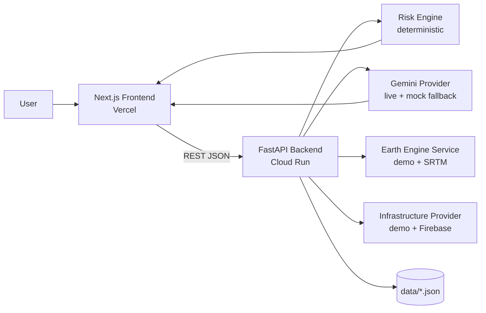

# RakshaAI — AI-Powered Pre-Disaster Intelligence Platform

> Instead of waiting for disaster damage reports, RakshaAI helps authorities understand **potential impact BEFORE the event** and prioritise action. Built for **Build with AI: Code for Communities — Second Edition**. Track: **Extreme weather / cyclone / flood anticipatory action**.

**The full flow:** Dashboard → Disaster Scenario → Run Simulation → Risk Map → Risk Breakdown → Critical Infrastructure Exposure → Gemini AI Analysis → Emergency Action Plan → Multilingual Alerts → State Emergency Brief — all in under 2 minutes.

---

## Problem

Tropical cyclones and floods strike India's long coastline every year. After a storm, response teams rely on post-event damage reports that can take hours to days to arrive. In that window critical decisions — where to pre-position rescue teams, which hospitals to protect, which routes to close, what to tell millions of citizens — are made with incomplete information.

## Solution

RakshaAI converts a **disaster scenario** into a **risk-intelligence brief in under 2 minutes**:

1. A scenario (cyclone / flood / extreme rainfall) with wind speed, rainfall, storm surge, impact radius and a state/district location.
2. A **deterministic, explainable risk engine** producing a transparent 0–100 "RakshaAI Prototype Risk Index" with flood, wind, population, infrastructure and accessibility components plus per-sector risk zones.
3. **Critical infrastructure exposure** — hospitals, shelters, power, water, roads, bridges — each with a risk score, threat and recommended action, prioritised P1/P2/P3.
4. **Gemini** reasoning that interprets the risk-engine output into a situation summary, priority areas, infrastructure concerns, recommended actions, pre-positioning and evacuation considerations.
5. A **phased emergency action plan** (Immediate / Before Impact / During Event / Recovery).
6. **Multilingual alerts** (English, Hindi, Telugu) for citizens and authorities.
7. A printable **State Emergency Brief**.

## Features

- India state → district location system (Andhra Pradesh, Odisha, West Bengal, Tamil Nadu, Gujarat; extensible via `data/locations.json`)
- Cyclone / Flood / Extreme Rainfall simulator with input validation
- Offline SVG risk map, with a live **Google Maps** overlay when `NEXT_PUBLIC_GOOGLE_MAPS_API_KEY` is set
- Transparent risk engine with configurable weights (`RISK_*_WEIGHT`)
- "Why is this area at risk?" per-sector explainability driven by actual engine values
- Infrastructure provider abstraction (demo data + Firebase stub)
- Gemini reasoning with automatic `MockGeminiProvider` fallback so the product always runs
- Demo Mode with realistic demo data, clearly labelled **DEMO DATA**

## Architecture



```text
frontend/   Next.js + TypeScript + Tailwind
backend/    Python FastAPI app
earth-engine/  GeoDataProvider notes + enablement guide
data/       locations & disaster-type catalogues (JSON)
docs/       architecture + Earth Engine guide
tests/      references (see backend/tests)
```

See `docs/ARCHITECTURE.md` for the provider abstractions and risk-engine detail.

## AI Approach

- The **risk engine** computes all numerical scores deterministically (weights: flood 30%, wind 25%, population 20%, infrastructure 15%, accessibility 10%).
- **Gemini** is used for *reasoning and decision support only*: situation summaries, priority identification, emergency recommendations, action plans, and multilingual communication. It never invents risk scores.
- When `GEMINI_API_KEY` is absent or the call fails, `MockGeminiProvider` produces deterministic equivalents labelled `DEMO · mock AI`.

## Google Technologies

| Technology | Role | Optional? |
|---|---|---|
| Gemini | Disaster-impact reasoning, action plans, multilingual alerts | Optional (fallback: mock) |
| Google Earth Engine | Geospatial/environmental data processing (SRTM elevation) | Optional (fallback: demo provider) |
| Google Maps | Map visualization and infrastructure context | Optional (fallback: built-in SVG map) |

Nothing is claimed to be "used" unless actually integrated. Without keys, the app runs fully in demo mode.

## Risk Engine

```
overall = flood×0.30 + wind×0.25 + population×0.20 + infrastructure×0.15 + accessibility×0.10
score 0–100 → LOW | MODERATE | HIGH | CRITICAL
```

Each component is trained-free, deterministic and returns human-readable factors. Scores are labelled **"RakshaAI Prototype Risk Index"** — explicitly not an official government/scientific formula and **not** an official track forecast (cyclone path is treated as scenario/forecast input).

## Data Sources

- `data/locations.json` — demo district catalogue (approximate elevation, population, flood-prone flags). **Not official statistics; labelled DEMO DATA.**
- Future real data path: IMD bulletins/rainfall, ISRO/Bhuvan, NASA SRTM / COP-DEM (via Earth Engine), OpenStreetMap, Census 2011 aggregates — see `data/README.md`.

## Demo Mode

Without any API keys the app is fully functional:

- Predefined demo scenario + "Load Demo Scenario" button
- Deterministic demo geospatial + infrastructure data
- Deterministic risk scores and zones
- `MockGeminiProvider` responses
- Clear **DEMO DATA** badges and provider status in the header
- A product-usage disclaimer panel

## Local Setup

Requirements: Python 3.11+ and Node.js 18+.

### Backend

```bash
cd backend
python -m venv .venv
# Windows:
.venv\Scripts\activate
# macOS / Linux:
source .venv/bin/activate

pip install -r requirements.txt
cp .env.example .env            # optional: add GEMINI_API_KEY
uvicorn app.main:app --reload
```

Verify: `http://localhost:8000/health` and Swagger at `http://localhost:8000/docs`.

### Frontend

```bash
cd frontend
npm install
cp .env.example .env.local      # optional: set NEXT_PUBLIC_API_URL
npm run dev
```

Open `http://localhost:3000`. To test the live backend URL use `NEXT_PUBLIC_API_URL=http://localhost:8000`.

## Environment Variables

See `.env.example`, `backend/.env.example` and `frontend/.env.example`.

| Variable | Where | Purpose | Required |
|---|---|---|---|
| `GEMINI_API_KEY` | backend | Live Gemini reasoning | No (mock fallback) |
| `GEMINI_MODEL` | backend | Model name (default `gemini-2.0-flash`) | No |
| `NEXT_PUBLIC_API_URL` | frontend | Backend base URL | No (defaults to `http://localhost:8000`) |
| `NEXT_PUBLIC_GOOGLE_MAPS_API_KEY` | frontend | Live Google Maps | No (SVG fallback) |
| `EARTH_ENGINE_*` | backend | Earth Engine integration | No (demo provider) |
| `FIREBASE_PROJECT_ID` | backend | Firebase repository | No |
| `RISK_*_WEIGHT` | backend | Risk-engine weights | No |

## Running Tests

```bash
cd backend
.venv\Scripts\python.exe -m pytest tests -q     # (Windows)
pytest tests -q                                  # (macOS/Linux)

cd ../frontend
npm run build
npm run lint
```

## Deployment

### Frontend → Vercel

```bash
cd frontend
vercel
```

Set `NEXT_PUBLIC_API_URL` to your deployed backend URL in the Vercel project settings (never hardcode it).

### Backend → Google Cloud Run

The root `Dockerfile` copies `backend/` + `data/`, honours `$PORT` (Cloud Run default 8080), and is built from the repo root:

```bash
gcloud auth login
gcloud config set project YOUR_PROJECT

# Build from the repo root (root Dockerfile copies backend/ and data/)
gcloud builds submit --tag gcr.io/YOUR_PROJECT/raksha-ai-backend .

# Store the Gemini key in Secret Manager — never pass keys as plain --set-env-vars
echo -n "YOUR_GEMINI_API_KEY" | gcloud secrets create gemini-api-key --data-file=-

gcloud run deploy raksha-ai-backend \
  --image gcr.io/YOUR_PROJECT/raksha-ai-backend \
  --platform managed --region asia-south1 \
  --allow-unauthenticated --port 8080 \
  --set-env-vars="CORS_ORIGINS=https://YOUR_FRONTEND.vercel.app,http://localhost:3000" \
  --set-secrets=GEMINI_API_KEY=gemini-api-key:latest
```

> **gcloud commas:** `--set-env-vars` splits entries on commas — escape a literal comma inside a value as `^,`, or pass the flag once per variable. Quote the whole `KEY=VALUE` list.

Then set `NEXT_PUBLIC_API_URL=https://raksha-ai-backend-RANDOM-UID.a.run.app` on Vercel.

## API Documentation

| Method | Endpoint | Purpose |
|---|---|---|
| GET | `/health` | Provider status |
| GET | `/api/locations/states` | List states |
| GET | `/api/locations/{state}/districts` | List districts |
| GET | `/api/locations/disaster-types` | Disaster configuration |
| POST | `/api/scenarios/simulate` | Full simulation (scenario + risk + zones + infrastructure) |
| POST | `/api/risk/analyze` | Risk result only |
| GET | `/api/infrastructure` | Infrastructure for a location/radius |
| POST | `/api/ai/analyze` | Gemini situation analysis |
| POST | `/api/ai/action-plan` | Phased emergency action plan |
| POST | `/api/ai/alert` | Multilingual citizen/authority alert |
| POST | `/api/ai/state-brief` | State emergency brief |

AI endpoints accept `{ "simulation": <simulate response> }` and a `force_mock` query flag for offline demos. Full interactive docs at `/docs`.

## Limitations

- Prototype risk index — decision support only, not an official forecast or warning.
- Demo data for geography/infrastructure — not an official registry.
- Cyclone path is a scenario/forecast input; RakshaAI does not predict official tracks.
- Accessibility and population figures are modelled estimates.

## India Scalability

- Location catalogue is data-driven: adding any Indian state/district is a single JSON entry.
- Provider abstractions let real datasets (IMD, ISRO/Bhuvan, SRTM, OSM) replace demo data per state without touching the frontend.
- The engine is fully deterministic and cheap, so a state-scale deployment (run per district, roll up to a state brief) is straightforward.

## Future Scope

- Real IMD/ISRO feeds, live Earth Engine layers, OSM infrastructure import, Firebase persistence
- More disaster types (heatwave, landslide, earthquake) via the disaster configuration system
- Multi-district state-wide simulation and production alerting integrations
- PDF export and WhatsApp/SMS alert delivery
- Accessibility/target users: SDMA teams, district collectors, NDMA

## Hackathon Notes

**2-minute demo:** open the app → select state/district → **Run Simulation** → risk map, KPI cards, risk breakdown, infrastructure and "why at risk" appear → AI analysis + action plan auto-generate → generate citizen alert (EN/HI/TE) → generate State Emergency Brief → Print.

**Honesty:** every external service is optional; the product never pretends live data is present, never hides mock/fallback, and clearly labels demo estimates.