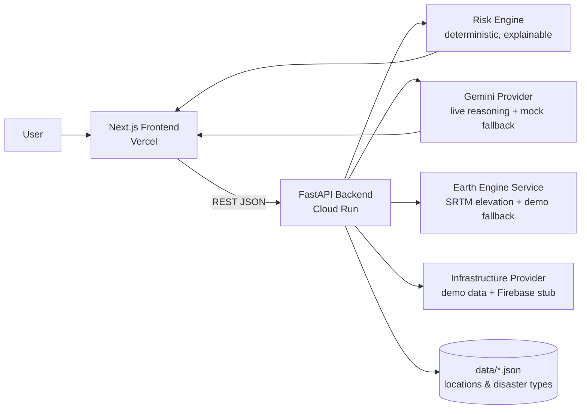

# RakshaAI — Architecture



## Layers

1. **Frontend (Next.js + TypeScript + Tailwind)**
   - `app/page.tsx` assembles the whole flow: Dashboard → Scenario → Run Simulation → Risk Map → Risk Breakdown → Infrastructure → AI Analysis → Action Plan → Multilingual Alerts → State Brief.
   - `features/simulation/useSimulation.ts` owns all panel state, loading and error handling.
   - `lib/api.ts` is the single API client; `lib/risk.ts` maps risk bands to colors/labels.

2. **Backend (FastAPI, Python)**
   - `api/routes.py` implements the public API, CORS, and graceful AI fallback.
   - `risk_engine/` computes all scores deterministically — the AI never invents numbers.
   - `gemini/` provides `GeminiProviderImpl` (live REST) and `MockGeminiProvider` (deterministic fallback).
   - `services/geo_data.py` provides `GeoDataProvider`: `DemoGeoDataProvider` (always works) and `EarthEngineProvider` (opt-in).
   - `infrastructure/providers.py` provides demo infrastructure generation and a Firebase stub.

3. **Data**: `data/locations.json` (states/districts) and `data/disaster_types.json`. Adding a state = adding one JSON entry.

## Provider abstractions

| Concern       | Interface               | Default (no keys)      | Live option              |
|---------------|-------------------------|------------------------|--------------------------|
| Geography     | `GeoDataProvider`       | `DemoGeoDataProvider`  | `EarthEngineProvider`    |
| Infrastructure| `InfrastructureProvider`| `DemoInfrastructureProvider` | `FirebaseInfrastructureProvider` |
| AI            | `GeminiProvider`        | `MockGeminiProvider`   | `GeminiProviderImpl`     |

## Deterministic risk engine

```
overall =
    flood         (rainfall, surge, elevation, coastal, flood-prone)  x 0.30
    wind          (wind speed, exposure)                              x 0.25
    population    (district population x area overlap)                x 0.20
    infrastructure(weighted asset risk inside radius)                 x 0.15
    accessibility (road density + disrupted links)                    x 0.10
```

Weights are configurable via env (`RISK_*_WEIGHT`). Scores are 0–100 → LOW / MODERATE / HIGH / CRITICAL. Every component returns human-readable `factors[]` used by the "Why is this area at risk?" panel.

## Gemini usage (scoping)

- Gemini **reasons over** risk-engine output: situation summary, priority areas, infrastructure concerns, recommended actions, resource priorities, evacuation considerations, communication guidance.
- Gemini **never computes** the numeric risk score.
- Gemini generates multilingual (EN/HI/TE) alerts and the state brief. If the key is absent or the call fails, `MockGeminiProvider` returns deterministic equivalents labelled `DEMO · mock AI`.